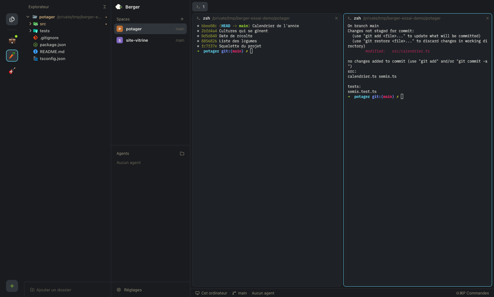
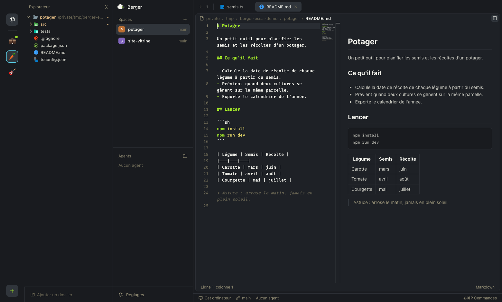

# Berger

Berger est un multiplexeur d'agents pour macOS : une seule fenêtre pour suivre
ses terminaux et ses agents de code (Claude Code et les autres), rangés par projets,
avec à côté un vrai éditeur de code, celui de VS Code (Monaco).

C'est une application Electron branchée sur
[herdr-core](#prérequis) : les terminaux tournent dans le core, pas dans
Berger. On peut quitter ou relancer Berger, les agents continuent leur travail.





## Fonctionnalités

### Workspaces, spaces et agents

- **Workspaces** : des groupes de projets, un emoji chacun dans la barre de
  gauche. Une pastille signale le workspace où un agent attend ou a fini.
- **Spaces** : un space par projet, avec sa branche git (ou `↑n` quand des
  commits restent à pousser). On les crée (`⌘N`), les renomme, les réordonne à
  la souris et on passe de l'un à l'autre (`⌃1`, `⌃2`…).
- **Agents** : la liste des agents du workspace, avec leur état (au travail,
  t'attend, fini), leur durée et le nom de leur space. Un clic ramène à leur
  terminal.
- **Sons** quand un agent attend ou finit pendant qu'on regarde ailleurs. On
  choisit le son de chaque alerte.

### Terminaux

- **Onglets et découpages** : nouvel onglet (`⌘T`), diviser à droite (`⌘D`) ou
  en bas (`⇧⌘D`), agrandir un panneau (`⇧⌘↵`), aller au panneau voisin
  (`⌥⌘←`), échanger deux panneaux. Un double clic sur une séparation égalise
  les panneaux.
- **Rendu par la carte graphique**, net et sans clignotement pendant qu'on
  redimensionne.
- **Liens cliquables** : `⌘`-clic sur une adresse web l'ouvre dans le
  navigateur.
- **Glisser-déposer** : un fichier déposé sur un terminal, depuis
  l'explorateur, le Finder ou une capture d'écran, y écrit son chemin.
- **Touches du Mac** : `⇧↵` pour un retour à la ligne, `⌘←` et `⌘→` pour aller
  au début ou à la fin de la ligne.

### Fichiers

- **Explorateur** : un dossier par space, plus les dossiers qu'on ajoute,
  avec les couleurs de git et les icônes Material. Les fichiers ignorés par git
  sont en grisé. On peut créer, renommer, copier, coller, déplacer (à la souris),
  sélectionner plusieurs fichiers (`⌘`-clic, `⇧`-clic) et mettre à la corbeille
  (avec confirmation).
- **Recherche rapide** (`⌘P`) avec les fichiers récents.
- **Onglets de fichiers** épinglables, réordonnés à la souris ; le dossier
  s'affiche quand deux fichiers portent le même nom.
- **Visionneuse** d'images et de vidéos.

### Éditeur

- **L'éditeur de VS Code**, avec ses grammaires et le thème Monokai identique à
  celui de VS Code.
- **Aide du langage** pour TypeScript, JavaScript, JSON (schémas de
  SchemaStore), YAML et Markdown : complétion, aller à la définition (`F12`,
  `⌘`-clic), références, survol, renommage, erreurs soulignées en tapant,
  « Organiser les imports ».
- **Aperçu Markdown** à côté du texte, mis à jour pendant la frappe.
- **Fichiers modifiés par un agent** : un fichier ouvert et non modifié se
  recharge tout seul ; modifié des deux côtés, Berger demande avant d'écraser.
- Retour à la ligne (`⌥Z`), minicarte, plusieurs curseurs, repli du code.

### Réglages

- **Fenêtre des réglages** (`⌘,`) ou fichier `reglages.json`, suivi à chaud.
- **Thèmes séparés** pour l'application (7 fournis, plus ceux au format de
  Herdr) et pour l'éditeur (9 fournis, dont ceux de VS Code).
- **Polices** de l'interface, de l'éditeur et du terminal, parmi celles du Mac.
- **Raccourcis** modifiables, avec détection des conflits.
- **Mises à jour de herdr-core** annoncées dans les réglages.

## Prérequis

- macOS.
- [Node.js](https://nodejs.org/) 22 ou plus récent.
- **herdr-core**, avec sa commande `hc` dans le `PATH`. Berger s'y connecte au
  lancement ; sans lui, la fenêtre l'indique et attend.

## Installer

```sh
npm install
npm run install-app
```

`npm run install-app` construit `Berger.app` et l'installe dans
`/Applications` (en remplaçant la version déjà installée).

## Développer

```sh
npm run dev        # lance Berger en développement
npm test           # tests des règles
npm run typecheck  # vérification des types
```

La version de développement range ses données dans
`~/Library/Application Support/Berger-dev/`, la version installée dans
`~/Library/Application Support/Berger/`.

Le code est rangé en trois parties : `src/main` (le processus principal :
connexion au core, fichiers, serveurs de langage), `src/renderer` (la fenêtre)
et `src/shared` (les règles pures, testées dans `tests/`). La feuille de route
est dans [`docs/suivi/ROADMAP.md`](docs/suivi/ROADMAP.md), les specs de chaque
phase dans `docs/superpowers/specs/` et les maquettes dans `docs/maquettes/`.
